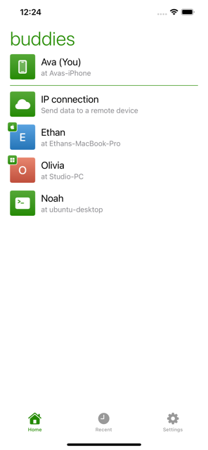
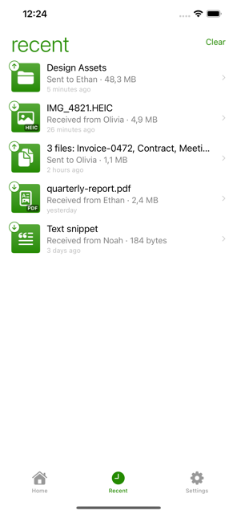
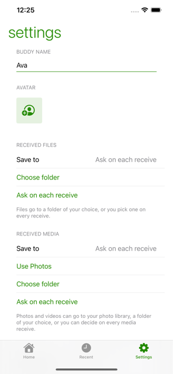

  

<h1 align="center">Dukto Link</h1>

Move files between your devices over the local network. No accounts, no cloud, no setup.

---

Dukto Link is the iOS edition of Dukto, the cross-platform LAN transfer tool created by
Emanuele Colombo. Open it next to Dukto on a Mac, Windows, Linux or Android machine on the
same network, pick what you want to send, tap the buddy it should reach, and it goes
straight across — the files never touch a server.

This page is the support home for the app. **Found a bug or have a question?**
[Open an issue](https://github.com/sukov/appsites/issues/new?template=dukto-link.yml) — that's the fastest way to
reach me.

  
  
  

## Getting started

1. Install Dukto on the other device (see [Dukto for your computer](#dukto-for-your-computer) below).
2. Put both devices on the same Wi-Fi network.
3. Open Dukto Link. When iOS asks for permission to find devices on your local network, allow it — without it your buddies can't be discovered.
4. Tap a buddy and choose what to send: text, the clipboard, files, a folder, or photos and videos.

Receiving works the same way in reverse. You decide where things land: a folder of your
choice, or straight into your photo library for media. Set a default in **Settings** and
Dukto Link stops asking.

## Dukto for your computer

Dukto Link talks to any Dukto client. Grab the latest desktop and Android builds from the
[Dukto releases page](https://github.com/xuzhen/dukto/releases/latest).

## Troubleshooting

**No buddies show up.**
Both devices need to be on the same network *and* the same network segment. Automatic
discovery is broadcast-based, so a router, a guest network, or client isolation on the
access point will hide your buddies even when both devices have internet. Check that:

- iOS granted the local network permission — **Settings › Dukto Link › Local Network**
- Both devices are on the same Wi-Fi (not one on Wi-Fi and one on cellular)
- The desktop client's firewall allows Dukto on port 4644 (TCP and UDP)
- VPNs are off, on both ends — they routinely break LAN discovery

**Still nothing? Send to an address directly.**
Tap **IP connection** on the buddies screen and type the other device's IP address. This
skips discovery entirely and works across segments, as long as the two machines can reach
each other. NAT and firewall traversal isn't guaranteed.

**A transfer stopped partway.**
Whatever arrived is kept, and the entry is marked in **Recent**. If you were the sender,
tap it and choose **Retry** to send it again.

**Transfers stop when I leave the app.**
iOS gives an app only a short window to finish work in the background. Big transfers need
Dukto Link on screen; if the system suspends the app first, the transfer is cancelled
cleanly and shows up in **Recent** so you can retry it.

**Where did my received files go?**
Wherever you chose. Files go to the folder set in **Settings › Received files**, and photos
and videos to the folder — or the photo library — set under **Received media**. Tapping a
row in **Recent** opens the item.

## Privacy

Dukto Link collects nothing. No analytics, no accounts, no tracking, no third-party SDKs,
and no server in the middle — your files go straight from one device to the other. The
full policy is here: [Privacy Policy](privacy/).

## Security

Dukto Link is built for networks you trust. Like the original Dukto, transfers are not
encrypted and there's no authentication beyond you choosing who to send to, so treat it as
a tool for your home or office network rather than for public Wi-Fi. Nothing is ever sent
without your explicit action.

## Support

[Open an issue](https://github.com/sukov/appsites/issues/new?template=dukto-link.yml) for bugs, questions and
feature ideas. You'll need a free GitHub account to post one.

When reporting a problem, it helps to include your iPhone and iOS version, the Dukto Link
version from **Settings › About**, and what the other device is running.

## Credits

Dukto was created by [Emanuele Colombo](https://www.msec.it/blog/dukto/) and is kept alive
across platforms by the community. Dukto Link is an independent iOS edition, built from
scratch in Swift and wire-compatible with the original protocol. It is free, and it stays
free.
